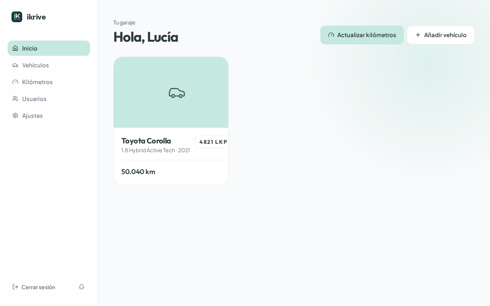
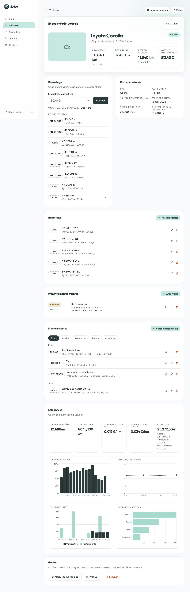
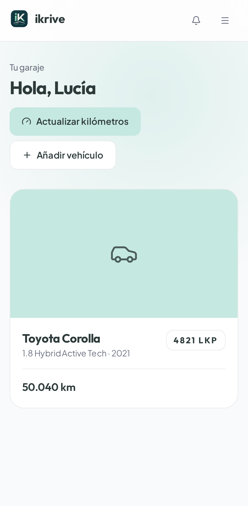

# Ikrive

**Tus vehículos, tus datos.** Ikrive es una aplicación open source y autoalojada para gestionar tus vehículos de forma privada:

- 🚗 **Vehículos**: marca, modelo, matrícula, VIN, foto y kilometraje.
- 🔧 **Mantenimiento**: cambios de aceite, neumáticos, ITV, averías… con sus facturas adjuntas.
- ⏰ **Recordatorios** por fecha o por kilometraje, con aviso semanal para actualizar los km (in-app y push vía ntfy, Gotify, Apprise o webhook) y feed de calendario.
- ⛽ **Repostajes y estadísticas**: km al año, consumo, coste por km y coste total de propiedad.
- 📄 **Informe de venta**: un PDF (y un enlace público) con todo el historial y las facturas para vender mejor y más rápido.
- 📦 **Tus datos son tuyos**: export e import en un zip, PWA instalable y varias cuentas en la misma instancia.

> Estado: **v0.2.0**, con app de Android conectada a tu servidor o con los datos solo en el teléfono ([docs/mobile.md](docs/mobile.md)). Cambios en el [CHANGELOG](CHANGELOG.md).



| | |
|---|---|
|  |  |
|  |  |

<details>
<summary>Expediente completo de un vehículo y vista móvil</summary>





</details>

## Instalación con Docker

```bash
curl -O https://raw.githubusercontent.com/alvarotloc/ikrive/main/docker-compose.yml
curl -o .env https://raw.githubusercontent.com/alvarotloc/ikrive/main/.env.example
# Edita .env: como mínimo BASE_URL y AUTH_SECRET (openssl rand -base64 48)
docker compose up -d
```

Abre `BASE_URL` (por defecto `http://localhost:3000`) y crea tu cuenta. **La primera cuenta es la de administrador.** Cuando hayas creado todas las que necesites, pon `DISABLE_SIGNUP=true`.

La [guía de autoalojamiento](docs/self-hosting.md) cuenta el resto:

- [Configuración: todas las variables de entorno](docs/self-hosting.md#variables-de-entorno)
- [Actualizar a una versión nueva](docs/self-hosting.md#actualizar)
- [Copias de seguridad: volumen `/data` y export por usuario](docs/self-hosting.md#copias-de-seguridad)
- [Exposición a internet para los enlaces públicos](docs/self-hosting.md#exposición-a-internet)
- [Lanzar los jobs de recordatorios a mano](docs/self-hosting.md#lanzar-los-jobs-a-mano)
- [App de Android (APK) y PWA en iPhone](docs/mobile.md)

## Desarrollo

Requisitos: Node 24 y pnpm (`corepack enable`).

```bash
pnpm install
pnpm dev          # API en :3000 y web en :5173 (con proxy de /api)
pnpm test         # tests
pnpm lint         # Biome
pnpm typecheck
pnpm test:e2e     # E2E con Playwright contra el build de producción
pnpm screenshots  # regenera las capturas de docs/screenshots/
pnpm --filter @ikrive/api job reminders   # lanza un job contra la BD de DATA_DIR (reminders | odometer-nudge)
```

Más detalles sobre la arquitectura y cómo contribuir en [CONTRIBUTING.md](CONTRIBUTING.md).

## Roadmap

- [x] Fundaciones: monorepo, API, auth multiusuario, ajustes, Docker y CI
- [x] Vehículos y odómetro
- [x] Mantenimiento y facturas
- [x] Recordatorios y notificaciones (in-app, ntfy, Gotify, Apprise)
- [x] Repostajes y estadísticas
- [x] Informe de venta (PDF y enlace público)
- [x] Exportar/importar, PWA y release v0.1.0
- [ ] App móvil: [app de Android](docs/mobile.md) con modo «Mi servidor» y modo «En este teléfono» sin servidor (v0.2.0); siguen pendientes partes de la fase 8 (ver [docs/PLAN.md](docs/PLAN.md))

## Licencia

[AGPL-3.0](LICENSE)
