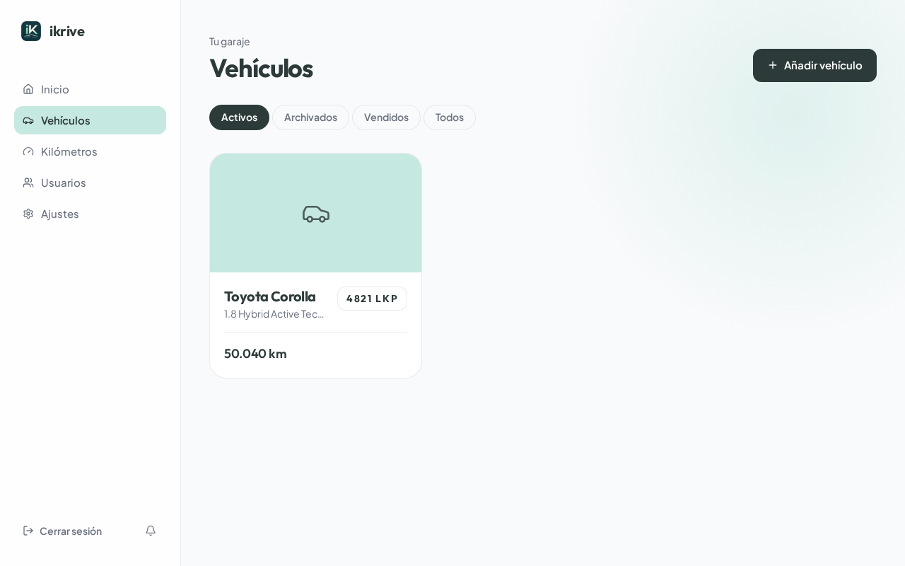
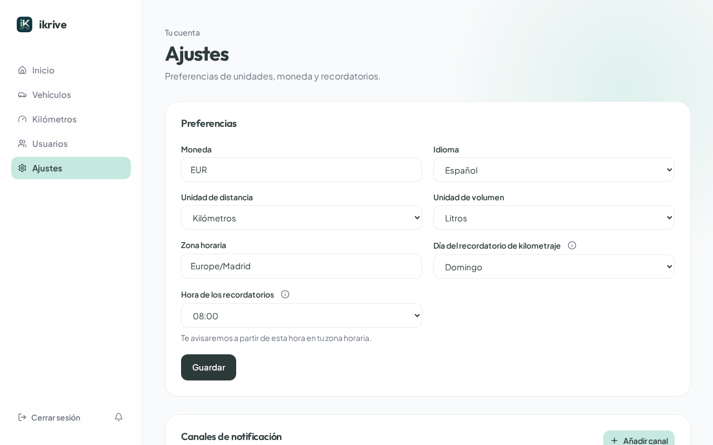
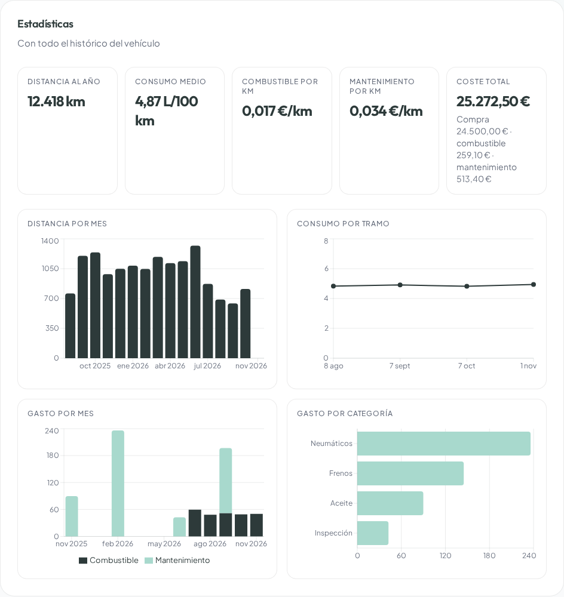
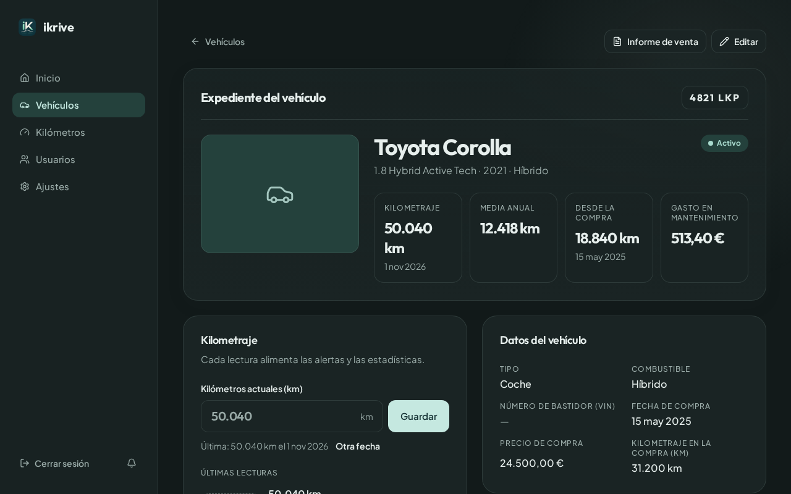

# Ikrive

**English** · [Español](README.es.md)

**Your vehicles, your data.** Ikrive is an open source, self-hosted app to manage your vehicles privately:

- 🚗 **Vehicles**: make, model, plate, VIN, photo and mileage.
- 🔧 **Maintenance**: oil changes, tyres, inspections, repairs… with their invoices attached.
- ⏰ **Reminders** by date or by mileage, with a weekly nudge to update the odometer (in-app and push via ntfy, Gotify, Apprise or webhook) and a calendar feed.
- ⛽ **Fuel-ups and statistics**: km per year, consumption, cost per km and total cost of ownership.
- 📄 **Sale report**: a PDF (and a public link) with the full history and invoices, to sell better and faster.
- 📦 **Your data is yours**: export and import in a zip, installable PWA and several accounts on the same instance.

The app is available in English and Spanish.

> Status: **v0.3.0**, with an Android app that connects to your server or keeps the data only on the phone, and photos from the phone camera ([docs/mobile.md](docs/mobile.md)). Changes in the [CHANGELOG](CHANGELOG.md).


| | |
|---|---|
|  |  |
|  |  |

<details>
<summary>Full vehicle record and mobile view</summary>


</details>

The screenshots show the Spanish interface.

## Install with Docker

```bash
curl -O https://raw.githubusercontent.com/alvarotloc/ikrive/main/docker-compose.yml
curl -o .env https://raw.githubusercontent.com/alvarotloc/ikrive/main/.env.example
# Edit .env: at least BASE_URL and AUTH_SECRET (openssl rand -base64 48)
docker compose up -d
```

Open `BASE_URL` (`http://localhost:3000` by default) and create your account. **The first account is the administrator.** Once you have created every account you need, set `DISABLE_SIGNUP=true`.

The [self-hosting guide](docs/self-hosting.md) covers the rest (in Spanish for now):

- [Configuration: every environment variable](docs/self-hosting.md#variables-de-entorno)
- [Updating to a new version](docs/self-hosting.md#actualizar)
- [Backups: the `/data` volume and per-user export](docs/self-hosting.md#copias-de-seguridad)
- [Exposing it to the internet for public links](docs/self-hosting.md#exposición-a-internet)
- [Running the reminder jobs by hand](docs/self-hosting.md#lanzar-los-jobs-a-mano)
- [Android app (APK) and PWA on iPhone](docs/mobile.md)

## Development

Requirements: Node 24 and pnpm (`corepack enable`).

```bash
pnpm install
pnpm dev          # API on :3000 and web on :5173 (proxying /api)
pnpm test         # tests
pnpm lint         # Biome
pnpm typecheck
pnpm test:e2e     # E2E with Playwright against the production build
pnpm screenshots  # regenerates the screenshots in docs/screenshots/
pnpm --filter @ikrive/api job reminders   # runs a job against the DATA_DIR database (reminders | odometer-nudge)
```

Architecture and contribution details in [CONTRIBUTING.md](CONTRIBUTING.md) (in Spanish). Questions and ideas go to [Discussions](https://github.com/Alvarotloc/Ikrive/discussions); bugs to [Issues](https://github.com/Alvarotloc/Ikrive/issues). To report a vulnerability, see [SECURITY.md](SECURITY.md). Everyone taking part follows the [Code of Conduct](CODE_OF_CONDUCT.md).

## Roadmap

- [x] Foundations: monorepo, API, multi-user auth, settings, Docker and CI
- [x] Vehicles and odometer
- [x] Maintenance and invoices
- [x] Reminders and notifications (in-app, ntfy, Gotify, Apprise)
- [x] Fuel-ups and statistics
- [x] Sale report (PDF and public link)
- [x] Export/import, PWA and v0.1.0 release
- [x] Mobile: [Android app](docs/mobile.md) with a «My server» mode and an «On this phone» mode without a server (v0.2.0), and camera photos (v0.3.0)
- [ ] v0.4.0: import from Fuelio, Drivvo, LubeLogger and generic CSV files, other expenses (insurance, tax, tolls…), documents with an expiry date and OIDC/SSO login

## License

[AGPL-3.0](LICENSE)
